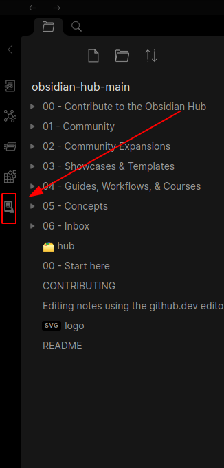
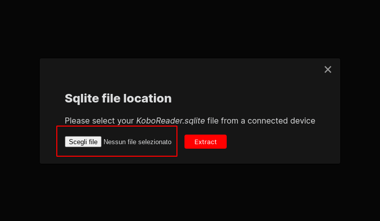
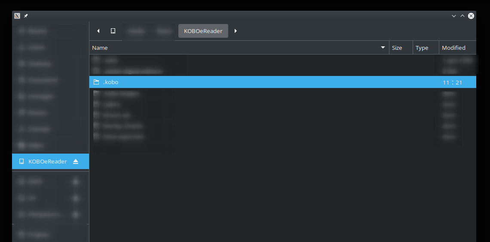
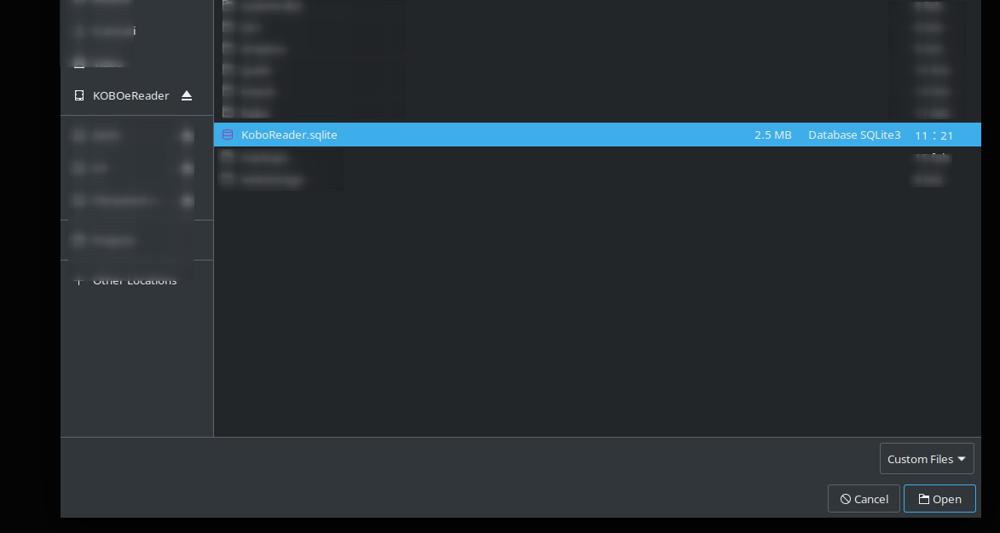

<div align="center">

# 📚 Obsidian Kobo Highlights Importer

**How do you get your Kobo highlights into Obsidian without retyping them?**
An Obsidian plugin that reads the Kobo database and writes your highlights into the vault.


[](LICENSE)


</div>

---

## Table of contents

- [Overview](#overview)
- [Install](#install)
- [Usage](#usage)
- [Development](#development)
- [Limitations](#limitations)
- [License](#license)

## Overview

The plugin opens the `KoboReader.sqlite` database stored on a Kobo e-reader and imports your highlights as notes in the vault. It was tested with a Kobo Libra 2 and a small number of books.

> **Maintenance status.** I am not actively maintaining this plugin any more. Feel free to fork it. A more actively developed fork is [OGKevin/obsidian-kobo-highlights-import](https://github.com/OGKevin/obsidian-kobo-highlights-import).

## Install

Download `main.js` and `manifest.json` from the [latest release](https://github.com/bitwiseops/obsidian-kobo-highlights-import/releases/latest) into `<your vault>/.obsidian/plugins/obsidian-kobo-highlights-importer-plugin/`, then enable the plugin in *Settings → Community plugins*.

## Usage

1. Connect the Kobo to your computer with a USB cable and make sure it is mounted.
2. Open the import window with the plugin's ribbon button.
3. Select `KoboReader.sqlite` from the device's hidden `.kobo` folder (enable hidden files in your file manager if you cannot see it).
4. Extract.

<p align="center">   </p>

## Development

```bash
npm install
npm run dev       # watch build
npm run build     # type-check and production build
```

The plugin is TypeScript bundled with esbuild, and reads the database with `sql.js`.

## Limitations

Desktop only. Highlights only: notes are not imported. You have to pick the `.sqlite` file by hand, and notes cannot be generated from templates. Tested on a single device model.

## License

[MIT](LICENSE) © 2022 Flavio Cordari
